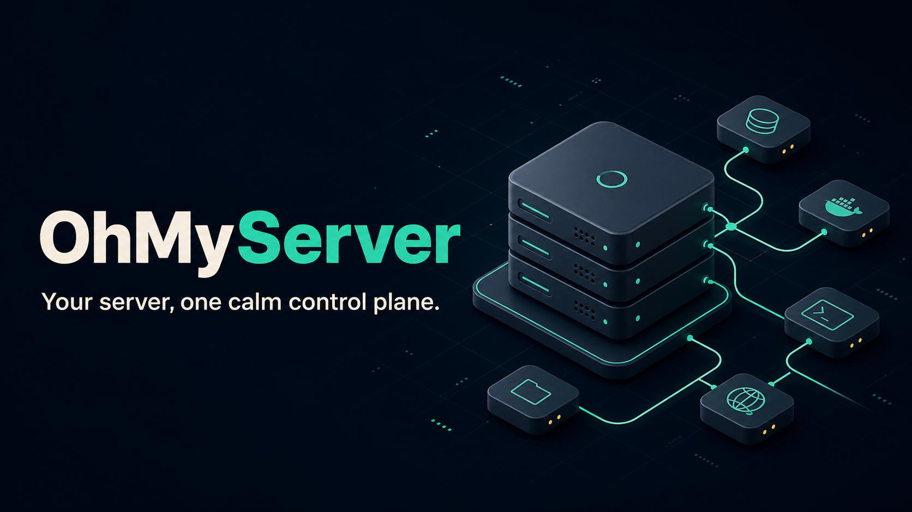

<p align="center">
  
</p>

# OhMyServer

OhMyServer is a lightweight, self-hosted control panel for running and maintaining your own servers. It brings system visibility, containers, deployments, networking, certificates, remote access, automation, and infrastructure integrations into one Go application.

## Install

On a Linux server with systemd:

```sh
curl -fsSL https://raw.githubusercontent.com/lsongdev/ohmyserver/main/install.sh | sudo sh
```

The installer downloads the latest release, creates a system service, and starts the panel on port `9000`.

> Review scripts before running them as root. The installer supports Linux on `amd64` and `arm64`.

## Highlights

- Single binary with an embedded web interface and SQLite storage
- Server monitoring, containers, deployments, DNS, proxying, and certificates
- SSH, terminals, scheduled jobs, file management, and remote device integrations
- Self-hosted by design, with no required external control plane

## From source

OhMyServer requires Go `1.26.1` or later.

```sh
git clone https://github.com/lsongdev/ohmyserver.git
cd ohmyserver
go build -o ohmyserver .
./ohmyserver
```

Open `http://localhost:9000`. Optional settings are documented in [`config.yaml.example`](config.yaml.example) and [`docs/`](docs/).

## Development

```sh
go test ./...
go run .
```

Contributions and issue reports are welcome.

## License

[MIT](LICENSE)
