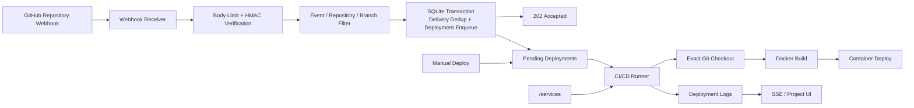

# 极简 CI/CD 服务设计

状态：Draft  
适用范围：OhMyServer 单机版第一阶段

## 1. 背景

OhMyServer 已经具备 CI/CD 所需的大部分基础能力：

- `projects` 保存项目和 Git 仓库地址；
- `deployments`、`deployment_logs` 保存部署状态和日志；
- `DeploymentExecutor` 可以检出代码、构建 Docker 镜像并启动容器；
- Project 页面支持手动部署、取消和 SSE 实时日志；
- `/services` 已经可以统一管理内置服务的期望状态与实际状态。

目前的部署入口只支持用户在页面中手动触发，而且 Handler 会直接创建
goroutine 执行部署。要支持 GitHub Webhook，还需要补齐：

1. Webhook 验签、事件过滤和重复投递去重；
2. 持久化任务队列，而不是在 HTTP 请求中直接启动 goroutine；
3. 按 Webhook 中的 commit SHA 精确检出代码；
4. 并发控制、重启恢复和同一项目的工作目录隔离；
5. 部署配置、触发来源和审计信息；
6. 与 `/services` 的统一运行状态管理。

## 2. 设计目标

### 2.1 第一阶段目标

- 支持 GitHub Repository Webhook 的 `ping` 和 `push` 事件；
- 每个 Project 可以独立启用 Webhook、设置分支和轮换 Secret；
- 使用 `X-Hub-Signature-256` 对原始请求体执行 HMAC-SHA256 验签；
- 使用 `X-GitHub-Delivery` 保证一次投递最多创建一个 Deployment；
- Webhook 在完成验证和持久化后立即返回，由后台 Runner 异步执行；
- 手动部署和 Webhook 部署进入同一个持久化队列；
- 精确构建 Webhook 指定的 commit，而不是构建收到事件时分支的最新提交；
- 复用现有 Deployment 详情页、取消操作、SQLite 日志和 SSE；
- 默认全局只执行一个任务，避免单机 Docker 构建争抢资源；
- OhMyServer 重启后恢复未开始的任务，并明确标记被中断的任务；
- CI/CD Runner 注册到 `/services`，统一展示运行状态和控制启停。

### 2.2 非目标

第一阶段不实现：

- GitHub Actions 兼容语法；
- 通用 Pipeline DAG、矩阵任务、并行 Stage；
- 在宿主机上执行仓库提供的任意 Shell 脚本；
- 多机器 Runner、分布式队列和远程执行；
- Pull Request 临时环境；
- Artifact 仓库和构建缓存服务；
- 自动创建 GitHub Check、Commit Status 或 PR 评论；
- GitHub App、OAuth 安装流程；
- GitLab、Gitea 等其他 Provider；
- 完整的蓝绿、金丝雀和多版本流量调度。

Webhook 本身只提供事件通知，不提供调用 GitHub API 的权限。因此首版不把
GitHub 状态回写作为隐含能力。

## 3. 核心结论

### 3.1 CI/CD 是 Project 的自动化能力，不是新的顶层资源

Project 继续作为仓库、构建配置和运行实例的所有者：

```text
Project
├── Automation Settings
│   ├── GitHub Webhook
│   ├── Branch Filter
│   └── Docker Build Settings
├── Deployments
│   ├── Manual
│   └── GitHub Webhook
└── Runtime Container
```

页面仍以 `/projects/{id}` 为入口，不新增含义重叠的 `/pipelines` 或
`/applications`。`Deployment` 同时表示一次 CI 构建和一次 CD 发布。

### 3.2 Webhook Receiver 与 Deployment Runner 分离

Webhook Receiver 属于 OhMyServer 控制面的 HTTP Handler，只做有限且快速的
工作：

1. 限制请求大小；
2. 读取原始请求体；
3. 验证签名；
4. 检查事件、仓库和分支；
5. 在数据库事务中去重并创建 Deployment；
6. 返回 `2xx`。

它不执行 Git、Docker 或健康检查。GitHub 建议 Webhook 接收端在 10 秒内返回，
并使用异步队列处理耗时任务：

- [Validating webhook deliveries](https://docs.github.com/en/webhooks/using-webhooks/validating-webhook-deliveries)
- [Best practices for using webhooks](https://docs.github.com/en/webhooks/using-webhooks/best-practices-for-using-webhooks)

Deployment Runner 是独立的后台循环，从 SQLite 原子领取任务并调用
`DeploymentExecutor`。手动部署也只负责入队。

### 3.3 第一阶段采用固定的 Docker Pipeline

首版流水线固定为：

```text
Checkout exact commit
        ↓
Build Docker image
        ↓
Create candidate container
        ↓
Start and verify
        ↓
Replace previous container
```

Dockerfile 本身可以使用 multi-stage build 执行编译和测试。OhMyServer 不直接
运行仓库中的 `test.sh`、`deploy.sh` 或任意宿主机命令，减少控制面被仓库代码
完全接管的风险。

### 3.4 SQLite 同时作为事实来源和持久化队列

单机版不引入 Redis、RabbitMQ 或独立 Queue Server。`deployments.status` 是
队列事实来源：

```text
pending → running → completed
                  ├→ failed
                  └→ cancelled

pending → superseded
running → failed (process restarted)
```

内存只保存当前执行器和取消函数，不能成为任务是否存在的唯一依据。

## 4. 总体架构



关键边界：

- GitHub 只接触公开的 Webhook Endpoint；
- 普通管理页面继续使用 OhMyServer 登录认证；
- Webhook Secret 只用于验签，不能用于登录或调用其他 API；
- Runner 只领取数据库中的任务，不直接接收外部请求；
- Docker 执行和日志都归属于一个不可变的 Deployment ID。

## 5. GitHub Webhook 设计

### 5.1 Endpoint

```http
POST /hooks/github/{publicID}
Content-Type: application/json
X-GitHub-Event: push
X-GitHub-Delivery: <guid>
X-Hub-Signature-256: sha256=<hex>
```

`publicID` 是随机生成的路由标识，不是认证凭据。每个 Project 使用独立
`publicID` 和独立 Secret，避免一个 Project 泄漏 Secret 后影响全部项目。

该路由不经过用户 Session/Auth Middleware，但必须经过：

- 请求方法和 Content-Type 检查；
- 请求体大小限制；
- HMAC 验签；
- 基于 Endpoint 的速率限制；
- 数据库去重。

### 5.2 Secret

- 使用 `crypto/rand` 生成至少 32 bytes 随机值；
- UI 创建或轮换时只完整显示一次；
- 数据模型字段使用 `json:"-"`，模板和日志禁止输出；
- Secret 不放在 URL、查询参数或 Git 仓库；
- 第一阶段沿用 OhMyServer 当前的单机信任边界，保存在权限受限的 SQLite；
- `~/.ohmyserver` 目录应为 `0700`，数据库文件应为 `0600`；
- 后续统一实现主密钥列加密时，再迁移 Webhook Secret 和其他设备凭据。

GitHub 使用原始请求体和 Secret 计算 `X-Hub-Signature-256`。实现必须：

```go
mac := hmac.New(sha256.New, secret)
mac.Write(rawBody)
expected := []byte("sha256=" + hex.EncodeToString(mac.Sum(nil)))
valid := hmac.Equal(expected, []byte(signatureHeader))
```

不能先反序列化 JSON 再重新编码后验签，也不能使用普通字符串 `==` 比较签名。

### 5.3 请求限制

- 默认最大请求体：`2 MiB`，允许通过配置提高，但不得超过 GitHub 的 payload
  上限；
- Header 长度继续使用 Go HTTP Server 的全局限制；
- 只接受 `application/json`；
- 验签失败返回通用 `401 Unauthorized`，不暴露 Project 是否存在或具体差异；
- 未知 `publicID` 返回 `404 Not Found`；
- 不保存验签失败的原始请求体。

### 5.4 事件处理

首版只处理：

| Event | 行为 |
|---|---|
| `ping` | 验签成功后返回 `200 OK`，不创建 Deployment |
| `push` | 检查仓库、分支、删除标记和 commit 后入队 |
| 其他事件 | 返回 `200 OK` 并记录为 ignored |

`push` 事件需要读取的最小字段：

```json
{
  "ref": "refs/heads/main",
  "before": "...",
  "after": "...",
  "deleted": false,
  "head_commit": {
    "id": "...",
    "message": "...",
    "author": {
      "name": "..."
    }
  },
  "repository": {
    "id": 123,
    "full_name": "owner/repository",
    "clone_url": "https://github.com/owner/repository.git",
    "ssh_url": "git@github.com:owner/repository.git"
  },
  "sender": {
    "login": "user"
  }
}
```

过滤顺序：

1. `X-GitHub-Event` 必须是 `ping` 或 `push`；
2. `deleted` 为 true 的分支删除事件直接忽略；
3. `repository.id` 必须与已绑定 ID 一致；
4. 首次绑定时可用严格规范化后的 `repository.full_name` 匹配，再保存
   `repository.id`；
5. `ref` 必须匹配配置的 `refs/heads/<branch>`；
6. `after` 必须是有效的 40 位 Git commit SHA；
7. 使用 `X-GitHub-Delivery` 去重。

仓库匹配最终以 GitHub `repository.id` 为准，避免仓库改名或 HTTPS/SSH URL
写法不同导致误匹配。

### 5.5 响应约定

| 场景 | Status | Body |
|---|---:|---|
| `ping` 成功 | 200 | `{"status":"ok"}` |
| 已接受并入队 | 202 | `{"status":"queued","deployment_id":123}` |
| 重复 Delivery | 200 | `{"status":"duplicate","deployment_id":123}` |
| 事件或分支被忽略 | 200 | `{"status":"ignored","reason":"branch"}` |
| 签名无效 | 401 | 通用错误 |
| Endpoint 不存在 | 404 | 通用错误 |
| 请求体过大 | 413 | 通用错误 |
| 数据库暂时不可用 | 503 | 通用错误，允许 GitHub 后续 redelivery |

不在 Webhook 响应中返回构建日志、Secret、仓库凭据或内部文件路径。

## 6. 数据模型

### 6.1 Project 自动化设置

使用独立表，避免继续把大量可选字段堆入 `projects`：

```sql
CREATE TABLE project_automation (
    project_id INTEGER PRIMARY KEY,
    enabled INTEGER NOT NULL DEFAULT 0,
    provider TEXT NOT NULL DEFAULT 'github',
    repository_id INTEGER,
    repository_full_name TEXT NOT NULL DEFAULT '',
    branch TEXT NOT NULL DEFAULT 'main',
    dockerfile TEXT NOT NULL DEFAULT 'Dockerfile',
    context_dir TEXT NOT NULL DEFAULT '.',
    image_name TEXT NOT NULL DEFAULT '',
    container_name TEXT NOT NULL DEFAULT '',
    webhook_public_id TEXT NOT NULL UNIQUE,
    webhook_secret TEXT NOT NULL,
    created_at DATETIME DEFAULT CURRENT_TIMESTAMP,
    updated_at DATETIME DEFAULT CURRENT_TIMESTAMP,
    FOREIGN KEY (project_id) REFERENCES projects(id) ON DELETE CASCADE
);
```

约束：

- `provider` 首版只允许 `github`；
- `branch` 是单个分支名称，不接受任意正则；
- `dockerfile` 和 `context_dir` 必须是仓库内相对路径；
- 清理路径后不得为绝对路径，也不得通过 `..` 逃逸工作目录；
- `image_name` 为空时使用 `ohmyserver/<project>:<short-sha>`；
- `container_name` 为空时使用规范化后的 Project 名称。

### 6.2 Webhook Delivery

只保存调度和审计所需字段，不保存完整 payload：

```sql
CREATE TABLE webhook_deliveries (
    id INTEGER PRIMARY KEY AUTOINCREMENT,
    provider TEXT NOT NULL,
    delivery_id TEXT NOT NULL,
    project_id INTEGER NOT NULL,
    event TEXT NOT NULL,
    repository_id INTEGER,
    repository_full_name TEXT NOT NULL DEFAULT '',
    ref TEXT NOT NULL DEFAULT '',
    commit_sha TEXT NOT NULL DEFAULT '',
    sender TEXT NOT NULL DEFAULT '',
    outcome TEXT NOT NULL,
    deployment_id INTEGER,
    error TEXT NOT NULL DEFAULT '',
    delivery_count INTEGER NOT NULL DEFAULT 1,
    received_at DATETIME DEFAULT CURRENT_TIMESTAMP,
    last_received_at DATETIME DEFAULT CURRENT_TIMESTAMP,
    processed_at DATETIME,
    UNIQUE(provider, delivery_id),
    FOREIGN KEY (project_id) REFERENCES projects(id) ON DELETE CASCADE,
    FOREIGN KEY (deployment_id) REFERENCES deployments(id) ON DELETE SET NULL
);

CREATE INDEX idx_webhook_deliveries_project
ON webhook_deliveries(project_id, received_at DESC);
```

`outcome` 可取：

- `queued`
- `ignored`
- `failed`

验签失败不写入该表，避免攻击者用无效请求填满数据库。
重复 Delivery 不创建新行，也不修改原来的 outcome；只增加
`delivery_count`、更新 `last_received_at`，并返回原 `deployment_id`。

### 6.3 Deployment 扩展

保留现有表和状态，增加触发与执行快照：

```sql
ALTER TABLE deployments ADD COLUMN source TEXT NOT NULL DEFAULT 'manual';
ALTER TABLE deployments ADD COLUMN source_delivery_id TEXT NOT NULL DEFAULT '';
ALTER TABLE deployments ADD COLUMN ref TEXT NOT NULL DEFAULT '';
ALTER TABLE deployments ADD COLUMN attempt INTEGER NOT NULL DEFAULT 1;
ALTER TABLE deployments ADD COLUMN priority INTEGER NOT NULL DEFAULT 0;
ALTER TABLE deployments ADD COLUMN config_snapshot TEXT NOT NULL DEFAULT '{}';
ALTER TABLE deployments ADD COLUMN error_message TEXT NOT NULL DEFAULT '';
ALTER TABLE deployments ADD COLUMN superseded_by INTEGER;
```

说明：

- `commit` 继续保存准确 SHA；
- `triggered_by` 保存 GitHub sender 或 OhMyServer 用户；
- `source` 首版为 `manual` 或 `github_push`；
- `config_snapshot` 保存入队时的构建配置，避免排队期间修改设置改变任务；
- `source_delivery_id` 用于 Deployment 页面反查 Delivery；
- `priority` 预留手动任务优先级；
- `superseded_by` 指向取代当前任务的新 Deployment。

新增状态：

```go
DeploymentStatusSuperseded DeploymentStatus = "superseded"
```

## 7. 入队与幂等

Webhook 入队必须在同一个 SQLite 事务中完成：

1. 尝试插入 `webhook_deliveries`；
2. 唯一键冲突时读取已有 `deployment_id`，返回 duplicate；
3. 读取并验证 Project Automation；
4. 对同一 Project 尚未运行的旧 Webhook 任务执行合并；
5. 创建 `pending` Deployment；
6. 更新 Delivery 的 `deployment_id` 和 `outcome=queued`；
7. 提交事务；
8. 非阻塞唤醒 Runner。

合并策略采用 “latest push wins”：

- 同一 Project、同一分支的旧 `pending github_push` 标记为 `superseded`；
- 已经 `running` 的任务默认不中断；
- 手动 Deployment 不被 Webhook supersede；
- 不同 Project 互不合并。

这样连续 push 不会让单机 Runner 构建已经过时的每一个 commit，同时仍保留完整
审计记录。

## 8. Runner 与并发模型

### 8.1 Runner

```go
type DeploymentRunner struct {
    server        *Server
    wake          chan struct{}
    stop          chan struct{}
    maxConcurrent int

    mu      sync.RWMutex
    running map[int64]*DeploymentExecutor
}
```

第一阶段：

- `maxConcurrent = 1`；
- `wake` 容量为 1，只表达“队列可能有新任务”，不承载任务数据；
- 即使唤醒信号丢失，Runner 也周期性查询 SQLite；
- 所有 `running` map 读写必须经过 mutex；
- 取消操作通过 Runner 查找执行器，而不是直接访问 Server 上的裸 map。

控制面启动配置只保留 Runner 级别参数，Project 构建配置继续存 SQLite：

```yaml
cicd:
  max_concurrent: 1
  webhook_max_body_bytes: 2097152
  poll_interval_seconds: 2
  successful_workspace_retention_hours: 24
  failed_workspace_retention_hours: 168
```

这些参数修改后由 CI/CD Runner Reload 读取；如果实现阶段无法安全热更新并发数，
则先明确标注为重启 OhMyServer 后生效。

### 8.2 原子领取

Runner 使用事务领取一个任务：

```sql
UPDATE deployments
SET status = 'running',
    started_at = CURRENT_TIMESTAMP,
    updated_at = CURRENT_TIMESTAMP
WHERE id = ?
  AND status = 'pending';
```

只有 `RowsAffected() == 1` 才能执行。选择顺序：

```sql
ORDER BY priority DESC, created_at ASC, id ASC
```

即使以后增加多个 worker，也不会重复领取同一个 Deployment。

### 8.3 重启恢复

OhMyServer 启动时：

- `pending` 保持不变，由 Runner 继续领取；
- 上次进程遗留的 `running` 标记为 `failed`；
- `error_message` 写入 `OhMyServer restarted while deployment was running`；
- 不自动重跑中断任务，因为容器替换可能已经产生部分副作用；
- 用户可以从详情页 Retry，Retry 创建新的 Deployment 和 attempt；
- 临时工作目录由启动清理任务根据 Deployment 状态和保留时间删除。

### 8.4 停止服务

`CI/CD Runner` 注册到 `/services`：

| Action | 行为 |
|---|---|
| Start | 开始领取 pending Deployment |
| Stop | 停止领取新任务，正在运行的任务允许完成 |
| Reload | 重新读取并发和保留策略 |

Runner 停止时 Webhook Receiver 仍然验签并接受任务，Deployment 保持 pending。
单个 Deployment 的 Cancel 是独立操作，不等价于停止整个 Runner。

状态摘要示例：

```text
running · 1 active · 3 queued
paused · 3 queued
idle · 0 queued
error · database unavailable
```

Runner 不监听网络端口，因此 `/services` 的 Bindings 一栏为空。

## 9. Deployment 执行

### 9.1 独立工作目录

当前按 Project 名称复用工作目录会导致并发部署互相删除文件。新路径必须按
Deployment 隔离：

```text
~/.ohmyserver/workspace/deployments/<deployment-id>/
```

执行完成后：

- 成功任务保留短时间用于诊断；
- 失败任务可保留更长时间；
- 默认只保留日志和元数据，工作目录按保留策略删除；
- 删除目标必须由已验证的 Deployment ID 构造，不能接受用户提供的绝对路径。

### 9.2 精确检出 commit

Webhook 触发必须构建 `after` 指定的 SHA：

```text
git init
git remote add origin <project.repo>
git fetch --depth=1 origin <commit-sha>
git checkout --detach FETCH_HEAD
git rev-parse HEAD
```

最后一步必须与期望 SHA 完全一致。不允许 fetch 失败后静默退回分支最新版本。

手动部署可以先解析配置分支 HEAD，再把得到的 SHA 写入 Deployment，后续同样走
精确检出流程。

私有仓库首版支持已有 Git 传输能力，例如配置在服务器上的 SSH Deploy Key。
自动创建 Deploy Key、GitHub App Token 和凭据管理留到后续版本。

### 9.3 Docker Build

镜像标签不得只使用 `latest`：

```text
ohmyserver/<project>:<short-sha>
```

同时可以维护一个方便识别的别名，但 Deployment 必须记录不可变 commit 标签或
镜像 digest。

构建要求：

- build context 和 Dockerfile 路径限制在工作目录内；
- 流式保存 Docker build 日志；
- Context、Dockerfile、commit 和 image tag 写入日志开头；
- 不把 Webhook Secret、Git 凭据或环境变量值写入日志；
- 取消 context 时应终止 Git 和 Docker Build；
- Build 失败不能影响当前正在运行的旧容器。

### 9.4 Container Replace

部署顺序：

1. 完成镜像构建；
2. 记录当前 Project 的运行容器；
3. 使用 `<container-name>-candidate-<deployment-id>` 创建候选容器；
4. 如果没有端口冲突，先启动候选容器；
5. 如果镜像包含 Docker `HEALTHCHECK`，等待 `healthy`；
6. 没有 Healthcheck 时至少确认容器在短暂观察期后仍为 running；
7. 切换成功后停止并删除旧容器，再把候选容器重命名为稳定名称；
8. 候选容器失败时删除候选并保持或恢复旧容器。

如果容器直接占用相同 Host Port，无法同时启动两个版本，则允许短暂停机：

1. 镜像先构建完成；
2. 停止旧容器；
3. 启动候选容器并验证；
4. 失败时重新启动旧容器。

首版称为 “safe replace”，不宣称无停机部署。真正的零停机应结合内置 Web
Server 的 upstream 切换单独设计。

### 9.5 取消

取消必须产生明确状态：

- `pending`：直接更新为 `cancelled`；
- `running`：调用 context cancel，等待 Executor 收尾后更新为 `cancelled`；
- `completed`、`failed`、`cancelled`、`superseded`：返回冲突，不重复修改；
- 因 cancel 导致的 Git/Docker 错误不能覆盖成 `failed`。

## 10. 路由和页面

### 10.1 外部 Webhook

```text
POST /hooks/github/{publicID}
```

该路由必须在代码中明确标记为公开 Webhook，不应误套普通用户登录认证，也不能
因为公开而跳过 HMAC 验证。

### 10.2 Project 页面

沿用现有路由：

```text
GET  /projects/{id}
GET  /projects/{id}/deployments
POST /projects/{id}/deployments
GET  /projects/{id}/deployments/{deploymentId}
GET  /projects/{id}/deployments/{deploymentId}/logs
POST /projects/{id}/deployments/{deploymentId}/cancel
```

新增：

```text
GET|POST /projects/{id}/automation
POST     /projects/{id}/automation/webhook/rotate
POST     /projects/{id}/deployments/{deploymentId}/retry
GET      /projects/{id}/deliveries
```

任何包含 `projectID` 和 `deploymentID` 的 Handler 都必须验证
`deployment.project_id == projectID`，不能只验证两条记录分别存在。

### 10.3 Automation 页面

页面展示：

- Enabled；
- GitHub Repository；
- Branch；
- Dockerfile；
- Build Context；
- Image Name；
- Container Name；
- Payload URL；
- Webhook Secret 创建/轮换结果；
- 最近 Delivery；
- “Send test ping” 的 GitHub 配置说明。

表单遵循项目公共规范：

- `<form class="form">`；
- `<input class="input" type="...">`；
- select 和 textarea 使用 `class="input"`；
- 每个控件都有 `label for`、`id` 和 `name`；
- Secret 留空表示不修改；
- Rotate Secret 必须二次确认，并提示旧 Secret 会立即失效。

Deployment 列表增加：

- Source；
- Branch/Ref；
- Commit；
- Triggered By；
- Queue/Run Duration；
- Attempt；
- Delivery ID。

## 11. 代码组织

建议文件：

```text
server/
  cicd.go                  # Schema、模型、CRUD、Automation 页面
  github_webhook.go        # GitHub Header、Payload、验签、事件过滤
  deployment_queue.go      # Runner、领取、恢复、取消、Service Adapter
  deploy.go                # 单次 DeploymentExecutor
web/projects/
  automation.html
  deliveries.html
  deployments.html
  deployment_detail.html
```

职责边界：

```go
type DeploymentQueue interface {
    Enqueue(ctx context.Context, request DeploymentRequest) (*Deployment, error)
    Cancel(ctx context.Context, deploymentID int64) error
    Retry(ctx context.Context, deploymentID int64) (*Deployment, error)
}

type SourceCheckout interface {
    Checkout(ctx context.Context, repo, commit, destination string) error
}

type DeploymentEngine interface {
    Execute(ctx context.Context, deployment *Deployment) error
}
```

Webhook Handler 只依赖 `DeploymentQueue`，不直接依赖 Docker。这样验签、过滤和
去重测试不需要启动 Docker。

## 12. 安全模型

### 12.1 必须实现

- HTTPS 暴露 Webhook Endpoint；
- HMAC-SHA256 验签；
- `hmac.Equal` 常量时间比较；
- `X-GitHub-Delivery` 唯一约束；
- 只订阅所需 GitHub 事件；
- 请求体大小限制；
- 路径规范化和工作目录逃逸检查；
- 不在日志中保存 Secret、Authorization Header 或完整 Payload；
- Project 与 Deployment 所有权校验；
- Git 和 Docker 子进程继承可取消 Context；
- 数据库和配置目录使用受限文件权限；
- 容器默认不使用 `--privileged`、Host Network 或 Docker Socket；
- 不执行仓库中的宿主机脚本。

### 12.2 可选加固

- 使用 GitHub `/meta` 返回的 Hook IP 范围做允许列表；
- 入口层限速；
- 独立的只读 Deploy Key；
- 数据库 Secret 列加密；
- 构建资源限制；
- Docker BuildKit Secret Mount；
- Runner 独立低权限用户或独立进程。

IP Allow List 只能作为辅助措施，不能替代 HMAC。GitHub 会更新 Hook IP 范围，
静态写死后可能阻断正常投递。

## 13. 日志、审计与保留策略

Deployment 日志继续存入 `deployment_logs` 并通过现有 SSE 输出。

建议增加：

- 每条日志可选 `level` 和 `stage`；
- 每个 Deployment 默认日志上限；
- 超限后保留尾部并写入 truncation 标记；
- `webhook_deliveries` 默认保留 30 天；
- Deployment 元数据默认长期保留；
- 成功工作目录默认保留 1 天；
- 失败工作目录默认保留 7 天；
- Docker 镜像保留最近 N 个成功版本，删除前检查是否仍被容器引用。

Webhook Payload 默认不落盘。需要排查时保存经过字段白名单筛选的结构化元数据，
而不是完整请求。

## 14. 当前代码需要先修正的点

在接入 Webhook 前，应先重构现有手动部署路径：

1. `DeploymentsView` 不再直接创建 goroutine，改为统一 `Enqueue`；
2. `Server.deployments` 替换为带 mutex 的 Runner 状态；
3. 工作目录从 Project 名称改为 Deployment ID；
4. `git clone --depth=1 <repo>` 改为精确 SHA checkout；
5. Cancel 后明确写入 `cancelled`，不能被通用错误处理覆盖成 `failed`；
6. 所有状态更新检查合法状态转换；
7. Runner 启动时处理遗留 `running` 和 `pending`；
8. Docker Build 成功后再影响旧容器；
9. Deployment Detail、Logs、Cancel 验证 Project 所有权；
10. 数据库 map、取消操作和 Close Hook 通过统一 Runner 协调。

这些不是额外功能，而是 Webhook 自动触发上线前的可靠性前置条件。

## 15. 实施阶段

### Phase 1：统一 Deployment Queue

- 新增 Runner；
- 手动部署改为入队；
- 加锁管理执行器；
- 独立工作目录；
- 修正 cancel 和 restart recovery；
- `/services` 增加 CI/CD Runner。

验收结果：没有 Webhook 时，现有手动部署行为保持一致，但可排队、可恢复。

### Phase 2：Project Automation

- 新增 `project_automation`；
- Automation 设置页面；
- 精确 SHA checkout；
- 构建配置快照；
- 镜像 commit tag。

验收结果：手动部署也可以重现同一 commit 和同一配置。

### Phase 3：GitHub Webhook

- 新增公开 Endpoint；
- Secret 生成和轮换；
- 验签、ping、push、过滤；
- Delivery 幂等；
- latest-push-wins；
- Delivery 历史页面。

验收结果：GitHub push 可以在 10 秒内获得响应，并异步创建唯一 Deployment。

### Phase 4：Safe Replace

- 候选容器；
- Docker Healthcheck；
- 失败恢复旧容器；
- 镜像和工作目录清理策略。

验收结果：Build 失败不影响现有容器，启动失败能够恢复旧版本。

## 16. 测试与验收标准

### 16.1 Webhook

- GitHub 官方测试向量可以通过 HMAC 验签；
- 缺失签名、错误签名和修改后的 body 返回 401；
- 验签使用原始 UTF-8 bytes；
- 相同 `X-GitHub-Delivery` 重放只产生一个 Deployment；
- `ping` 不产生 Deployment；
- 非 `push` 事件不产生 Deployment；
- 错误仓库、错误分支和删除分支不产生 Deployment；
- 合法 push 返回 202，且响应不等待 Git/Docker；
- 超过限制的 body 返回 413；
- Secret 轮换后旧签名立即失效。

### 16.2 Queue

- 手动任务和 Webhook 任务走同一领取逻辑；
- 两个 Worker 竞争时只有一个能够领取同一 Deployment；
- 快速连续 push 只执行最新 pending commit；
- 手动任务不会被自动 supersede；
- 重启后 pending 继续执行；
- 重启遗留 running 被明确标记 failed；
- `go test -race` 下 running map 无数据竞争。

### 16.3 Executor

- 两个 Deployment 工作目录完全隔离；
- 实际 checkout SHA 与 Deployment.commit 一致；
- 路径不能逃逸工作目录；
- Build 失败时旧容器继续运行；
- Cancel 最终状态为 cancelled；
- 候选容器健康检查失败时旧容器恢复；
- 日志和页面不出现 Webhook Secret。

### 16.4 Handler

- Deployment Detail、Logs、Cancel、Retry 拒绝跨 Project ID 访问；
- 普通 Project 页面仍要求登录；
- Webhook Endpoint 不要求登录，但没有合法签名不能触发任务；
- 所有新表单使用 `.form`、`.input` 和显式 `input type`。

## 17. 后续扩展

保持以下扩展点，但不提前实现：

- GitHub App 安装和短期 Clone Token；
- Commit Status、Checks API 和 Deployment API 回写；
- `release`、`workflow_run`、`repository_dispatch` 事件；
- GitLab、Gitea Provider Adapter；
- 每项目并发策略；
- 通用 Stage 和容器化 Job；
- Build Cache 和 Artifact；
- Web Server Upstream 原子切换；
- 多节点 Runner；
- Environment、Approval 和 Protected Deployment；
- Secret Store。

只有在固定 Docker Pipeline 已经稳定、可恢复并有明确使用需求后，才应引入
Pipeline DSL。否则 DSL 会过早扩大调度、权限、日志、缓存和重试的复杂度。
